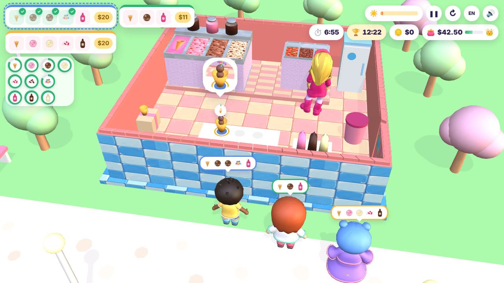
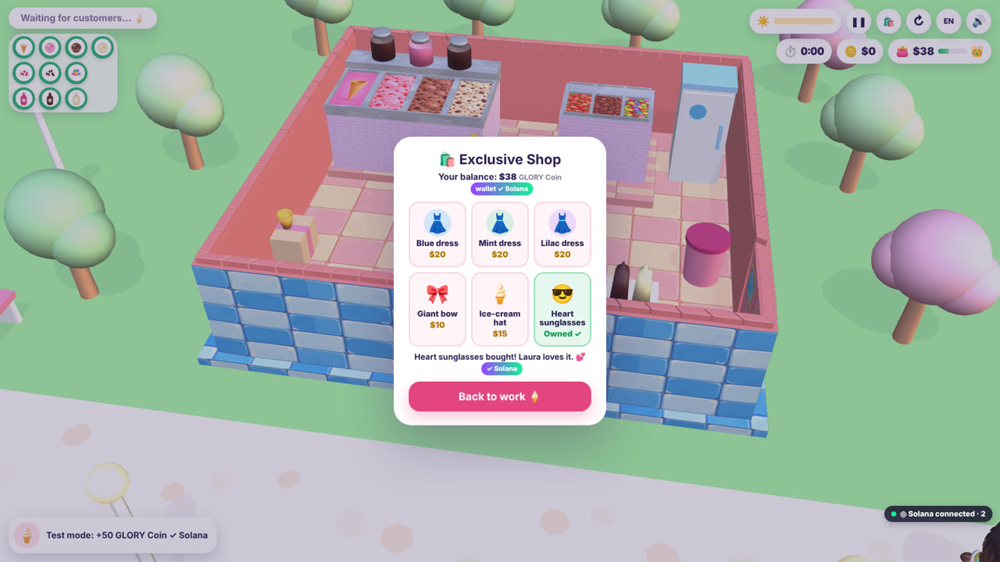
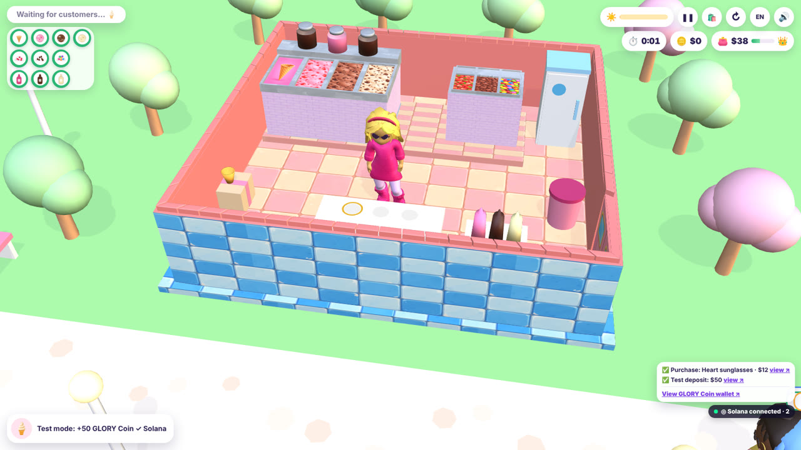
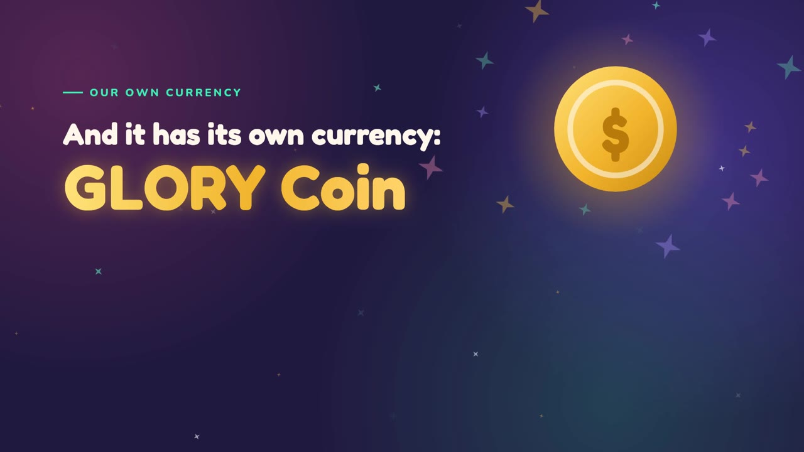
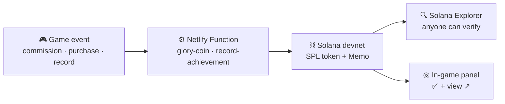
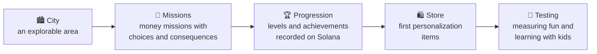

<div align="center">


### A really fun game about financial education.

An online world where heroes, villains and charming characters turn money into an adventure.<br>
**Fun comes first. Learning happens naturally.**

<br>

[](https://playglory.netlify.app/)
[](https://playglory.netlify.app/#pitch)
[](https://playglory.netlify.app/play/)
[](https://explorer.solana.com/address/DcYtJeK5iJ726BfCNy6P8trg2AEwwYQUqNeLgr2HmH6u?cluster=devnet)


<sub>🇧🇷 [Leia em português](README.pt-BR.md)</sub>

</div>

---

## 🎬 Pitch

<div align="center">

<a href="https://playglory.netlify.app/#pitch"></a>

**[▶ Watch the pitch](https://playglory.netlify.app/#pitch)** · 3 minutes<br>
<sub>The problem, our solution, the GLORY universe, Solana, business model and next steps.</sub>

</div>

---

## 🌐 Website

<div align="center">

<a href="https://playglory.netlify.app/"></a>

<a href="https://playglory.netlify.app/"></a>

<sub>Bilingual website (PT-BR / EN) with the pitch, the playable proof of concept, the characters and 3D footage of the city.</sub>

</div>

---

## 🍦 Playable proof of concept: Laura's Ice-Cream Shop

<div align="center">

<a href="https://playglory.netlify.app/play/"></a>

<a href="https://playglory.netlify.app/play/"></a>

</div>

Laura works at the ice-cream shop and earns **10% of every sale in GLORY Coin** to buy her **golden crown ($100)**. Serve fast, resist temptations and reach the goal. **With records on Solana.**

- 🍨 **Build every order:** cone, flavors, toppings and syrups. Ring the bell to deliver.
- 💰 **End of the day:** a simple sales summary and Laura's 10% commission, paid in GLORY Coin.
- 🛍️ **Temptations and an Exclusive Shop** with 6 items: buy now or focus on the crown? The choice is the kid's.
- 🐦 **A greedy seagull** tries to steal the toppings. Laura has to chase it away.
- 🏆 **The record** is the fastest work time to reach the crown, saved on the device and on Solana.
- ◎ **Solana panel:** every transaction appears in the corner of the game, with a link to the Solana Explorer.
- 📱 **Desktop and phone** (full screen, landscape) · PT-BR / EN.

<table>
<tr>
<td width="50%" align="center"><br><b>Exclusive Shop</b><br><sub>Every purchase is a GLORY Coin transfer on Solana</sub></td>
<td width="50%" align="center"><br><b>Solana panel</b><br><sub>✅ confirmed transactions, each with a "view ↗" link</sub></td>
</tr>
</table>

> 🧪 **Quick test:** [`/play/?teste=1`](https://playglory.netlify.app/play/?teste=1) starts with +50 GLORY Coin and 90-second days, so you can see the commission, a purchase and the Solana transactions in about two minutes. Test mode keeps its own save and never touches the real record.

---

## 📍 Contents

- [Pitch](#-pitch)
- [Website](#-website)
- [Playable proof of concept](#-playable-proof-of-concept-lauras-ice-cream-shop)
- [The problem](#-the-problem)
- [The idea](#-the-idea)
- [How it works](#-how-it-works)
- [Meet the cast](#-meet-the-cast)
- [GLORY is coming to life](#️-glory-is-coming-to-life)
- [How we got here](#-how-we-got-here)
- [Tech stack](#️-tech-stack)
- [Design principles](#-design-principles)
- [Solana](#-solana-achievements-that-go-beyond-the-game)
- [Business model & market](#-business-model--market)
- [Roadmap](#️-roadmap)
- [What's in this repository](#-whats-in-this-repository)
- [How to run](#-how-to-run)
- [Team](#-team)

---

## 💸 The problem

<table>
<tr>
<td align="center" width="50%"><h1>43.1%</h1>of Brazilian adults have a<br><b>negative credit record</b></td>
<td align="center" width="50%"><h1>78.8%</h1>of Brazilian families<br><b>are in debt</b></td>
</tr>
</table>

<sub>Source: Agência Senado (Brazilian Federal Senate).</sub>

> **Preventing debt is the best choice. And it starts in childhood.**

When we looked at what already exists, we found a pattern: **many financial games for kids are boring.** They are blocks of text. Kids read, click *next*, read again, click again.

*If it doesn't engage, it doesn't teach.*

---

## ✨ The idea

**GLORY is an online game where kids live the story instead of just reading it.**

A treasure city, two very different twin brothers, a villain who offers *easy money today*, and heroes who help everyone make better choices. Every mission is about money, and every choice has a consequence.

---

## 🎮 How it works

```
   🛠️ WORK             🪙 EARN              🤔 CHOOSE                 🌱 GROW
 Complete missions → Collect coins and → Spend, save or invest, → Unlock new areas,
 around the city     feel the value       and see what happens     missions and
                     of effort                                     achievements
```

| Choice | What happens in the game |
|---|---|
| 🛍️ **Spend** | You bought a snack now. Fewer coins for later. |
| 🐷 **Save** | Your piggy bank grows. Saving pays off! |
| 📈 **Invest** | Your coins are working for you. Patience brings more. |

**What kids learn along the way:** money · change · budgeting · saving · investing.

**Gameplay ideas in development**
- 🎣 **Ways to earn coins:** activities around the city, like fishing, mining, tending a vegetable garden and rescuing the *credit zombies*.
- 🏦 **In-game bank:** keep money safe, watch savings grow and, for older kids, transfers and a simulated card.
- 🛒 **Shop:** items to spend hard-earned coins on, so every choice carries weight.
- 🗣️ **Narrator:** a narrator guides the tutorial and the story, so kids can listen instead of only reading.

---

## 🦸 Meet the cast

<table>
<tr>
<td align="center"><br><b>Laura</b><br><sub>Hero. Brave, quick and always ready for the next mission.</sub></td>
<td align="center"><br><b>Nino</b><br><sub>Hero. Leads the green Jurildos with his golden staff.</sub></td>
<td align="center"><br><b>Valério & Prudêncio</b><br><sub>The twins who rule the Treasure City. Alike on the outside, very different on the inside.</sub></td>
</tr>
<tr>
<td align="center"><br><b>Dr. Crédito</b><br><sub>Villain. Offers easy money today…</sub></td>
<td align="center"><br><b>Red Jurildos</b><br><sub>…and his helpers make debts grow tomorrow.</sub></td>
<td align="center"><br><b>Green Jurildos</b><br><sub>Nino's crew, on the side of good choices.</sub></td>
</tr>
</table>

---

## 🏙️ GLORY is coming to life

Our characters and our city already exist in 3D. And we already have a [playable proof of concept](#-playable-proof-of-concept-lauras-ice-cream-shop), connected to Solana.

<table>
<tr>
<td width="50%" align="center"><br><b>Nino and Laura in 3D</b></td>
<td width="50%" align="center"><br><b>Valério and Prudêncio in 3D</b></td>
</tr>
<tr>
<td width="50%" align="center"><br><b>From white models to full color</b><br><sub>Modeling and texturing in Blender</sub></td>
<td width="50%" align="center"><br><b>First movement tests</b><br><sub>Laura's walk cycles and poses (Mixamo + Blender)</sub></td>
</tr>
<tr>
<td colspan="2" align="center"><br><b>The Treasure City in 3D</b><br><sub>A city full of shops, castles and gardens</sub></td>
</tr>
</table>

---

## 🧭 How we got here

> ℹ️ **Transparency note:** the art, 3D work and research below were produced **before the hackathon**. During the hackathon we built the public bilingual website, the pitch and the playable proof of concept, with the GLORY Coin and records live on Solana devnet.

### 1 · Research

We reviewed existing financial games for kids (Island Saver, Zogo, Night of the Living Debt, Miniconomy, Tindin, Rolê que Rende, Universo Caixa and others) and studied research on narrative and multimedia learning. We noticed that many of them are dull and offer little engagement. **So we decided to do it differently: build something that is genuinely fun.**


<details>
<summary><b>References</b></summary>

- Naul, E., & Liu, M. (2020). *Why Story Matters: A Review of Narrative in Serious Games.* Journal of Educational Computing Research, 58(3), 687–707.
- Mayer, R. E. (2009). *Multimedia Learning* (2nd ed.). Cambridge University Press.

</details>

### 2 · Character design

Every character follows the same pipeline: **moodboard → sketch → 2D art (Figma) → 3D model (Blender)**.


### 3 · Building the Treasure City

The city followed the same path: **moodboard → sketch → 2D map (Figma) → 3D city (Blender)**.


<table>
<tr>
<td width="72%" align="center"><br><sub><b>The city today</b>: islands, paths and districts built in Blender</sub></td>
<td width="28%" align="center"><br><sub><b>Island shapes</b>: from 2D outline to 3D terrain</sub></td>
</tr>
</table>

#### 🏗️ Inside the city: 3D models already built

Shops, vehicles, landmarks and decorations, all modeled and textured by the team, each with a money-themed twist.


<details>
<summary><b>See more models</b> (12 more)</summary>
<br>


</details>

### 4 · Story and customization

The Treasure City is ruled by twin brothers: **Prudêncio**, who plans and saves, and **Valério**, who loves expensive things and wants everything right now.<br>
Impatient, Valério makes a secret pact with **Dr. Crédito**, and easy money spreads across the city.<br>
At first, everyone celebrates. Then the debts grow faster than anyone can pay them back.<br>
The red Jurildos push the interest higher, and anyone who can't pay becomes a **credit zombie**.<br>
Prudêncio uncovers the truth, hits the emergency button… and an agent is called in: **you**.

Players choose and customize their agent, so kids of every ethnicity and look can see themselves in the game.


### 5 · Talking to kids and parents

We have already talked with kids and parents to hear what they enjoy, what they expect from a game about money and what makes them trust it. These conversations shape our characters, missions and the freemium model.

---

## 🛠️ Tech stack

| | Tool | Use |
|---|---|---|
| 🎨 | **Figma** | 2D characters and city map |
| 🧊 | **Blender** | 3D modeling and texturing |
| 🕺 | **Mixamo** | Character rigging and animation |
| 🎮 | **Unity** | Game engine for the full online game (MVP) |
| 🍦 | **Three.js** | Playable proof of concept in the browser |
| ⛓️ | **Solana** | GLORY Coin (SPL token) and records, live on devnet |
| 🧰 | **@solana/web3.js · @solana/spl-token · Memo Program** | Minting, transfers and on-chain records |
| ⚙️ | **Netlify Functions** | Server that signs the Solana transactions |
| 🌐 | **HTML · CSS · JS** | Public bilingual website |

---

## 🎨 Design principles

| Principle | Why |
|---|---|
| 📖 **Story first** | Strong characters pull kids into the story. |
| 🗣️ **Narration over reading** | People learn more from pictures and spoken words than from printed text. Narration also includes kids with reading difficulties or visual impairments. |
| 🧒 **Representation** | Customizing hair, skin, eyes and clothes lets every kid see themselves in the game. |
| 💻 **Lightweight by design** | *Low poly* graphics so the game runs well on simple computers too. |
| 🎯 **Consequences, not lectures** | Kids learn from what happens after their choices, not from warnings on the screen. |

---

##  Solana: achievements that go beyond the game

**With Solana, GLORY offers verifiable achievements. And it has its own currency: the GLORY Coin.**<br>
Every coin earned, every purchase and every record is recorded on Solana.

> ✅ **Live on Solana devnet:** [GLORY Coin token](https://explorer.solana.com/address/DcYtJeK5iJ726BfCNy6P8trg2AEwwYQUqNeLgr2HmH6u?cluster=devnet) · [a player wallet with real transactions](https://explorer.solana.com/address/EsoFY9wXbCv9hdKmBAmQFDzvwvK9PoJp4QKnTEFqemZ7?cluster=devnet)

<div align="center"></div>

| In the game | On Solana |
|---|---|
| 🍦 End of the day: Laura earns 10% of the sales | `MintTo` GLORY Coin to the player's wallet + memo `GLORY · day N commission (10% of sales)` |
| 🛍️ Buying an item in the shop | `Transfer` GLORY Coin back to the shop + memo `GLORY · bought "item"` |
| 👑 Reaching the golden crown | Memo with the record: days and work time |



- **SPL token:** the GLORY Coin is an SPL token with 2 decimals. Its mint address is derived from the game server key and created on first use.
- **Anonymous players:** each player gets a wallet derived from an anonymous player ID. No personal data goes on-chain.
- **Server-signed:** the game server signs the transactions and pays the network fees.
- **Works offline too:** progress is also saved on the device, so the game keeps working if the network is unavailable.

<details>
<summary><b>Code: paying the daily commission</b> (<code>glory-site/netlify/functions/glory-coin.mjs</code>)</summary>

```js
tx.add(
  createAssociatedTokenAccountIdempotentInstruction(treasury.publicKey, kidAta, kid.publicKey, mint.publicKey),
  createMintToInstruction(mint.publicKey, kidAta, treasury.publicKey, cents),
  memo(`GLORY · day ${day} commission (10% of sales) · ${(cents / 100).toFixed(2)} GLORY Coin · player ${player}`, treasury.publicKey));
const signature = await sendAndConfirmTransaction(connection, tx, [treasury]);
return Response.json({ ...out, signature, explorer: explorer(signature) });
```

</details>

---

## 💼 Business model & market

**Freemium, made for families.** The game is **free to play**. Revenue comes from:

| | |
|---|---|
| 👕 **Items** | Outfits and accessories for your character. No gameplay advantage. |
| 🗺️ **Special missions** | New stories and new challenges. |
| 🤝 **Partners** | Financial institutions and brands. |

**Initial focus: Brazil.** **27.4 million** children aged 5 to 14 <sub>(Source: IBGE, 2022 Brazilian Census)</sub>, with international expansion in the future.

---

## 🗺️ Roadmap

**MVP in 12 months:** from proof of concept to a complete, playable experience, online, built in **Unity**.



<sub>Month 1 → Month 12</sub>

---

## 📂 What's in this repository

```
glory/
├── netlify.toml                 # tells Netlify to build from glory-site/
├── glory-site/                  # Website + playable proof of concept (built during the hackathon)
│   ├── index.html               # Bilingual site (PT-BR / EN): pitch, proof of concept, universe, business
│   ├── play/                    # Laura's Ice-Cream Shop (Three.js)
│   ├── netlify/functions/
│   │   ├── glory-coin.mjs           # GLORY Coin on Solana: pay, buy, balance (+ health check)
│   │   └── record-achievement.mjs   # records on Solana (Memo Program)
│   ├── scripts/                 # devnet wallet helper
│   ├── package.json             # @solana/web3.js, @solana/spl-token
│   └── assets/                  # images, 3D footage, pitch video, soundtrack
└── docs/                        # README images and GIFs (design process, cast, city)
```

---

## 🚀 How to run

1. **Create a devnet wallet** for the game: `cd glory-site && npm install && npm run wallet`
2. **Fund it** with devnet SOL at [faucet.solana.com](https://faucet.solana.com) (it pays the network fees).
3. **Deploy on Netlify** from this repository (the root `netlify.toml` already points to `glory-site/`) and add the environment variable `GLORY_DEVNET_SECRET` with the wallet's secret key.
4. **Check:** `/.netlify/functions/glory-coin` should show `"ready": true`. Then open `/play/?teste=1` and watch the Solana panel.

---

## 👩‍💻 Team

<table>
<tr>
<td align="center" width="50%"><b>Noirane Sá</b><br><sub>Founder & developer</sub><br>Master's in Computer Science, with experience in the financial sector.</td>
<td align="center" width="50%"><b>Lucas Diniz</b><br><sub>Educational consultant</sub><br>Mathematician with experience in education.</td>
</tr>
</table>

<div align="center">

<br>

**We are building a world where learning about money means living adventures.**

<sub>© 2026 GLORY · All characters, art and 3D models are proprietary.</sub>

</div>
