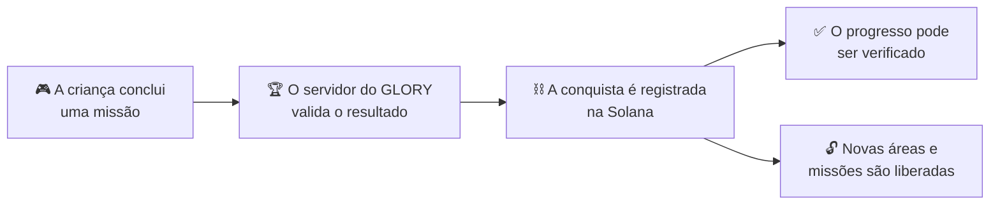
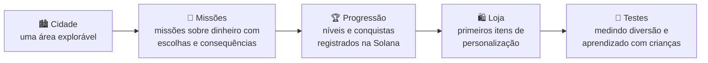

<div align="center">


### Um jogo realmente divertido sobre educação financeira.

Um mundo online onde heróis, vilões e personagens cativantes transformam o dinheiro em aventura.<br>
**A diversão vem primeiro. O aprendizado acontece naturalmente.**

<br>

[](https://playglory.netlify.app/)
[](https://playglory.netlify.app/#pitch)
[](#-solana-conquistas-que-vão-além-do-jogo)


<sub>🇺🇸 [Read in English](README.md)</sub>

</div>

---

## 🎬 Pitch

<div align="center">

<a href="https://playglory.netlify.app/#pitch"></a>

**[▶ Assistir ao pitch](https://playglory.netlify.app/#pitch)** · 3 minutos<br>
<sub>O problema, a nossa solução, o universo do GLORY, Solana, modelo de negócio e próximos passos.</sub>

</div>

---

## 🌐 Site

<div align="center">

<a href="https://playglory.netlify.app/"></a>

<a href="https://playglory.netlify.app/"></a>

<sub>Site bilíngue (PT-BR / EN) com o pitch, os personagens e os vídeos 3D da cidade.</sub>

</div>

---

## 📍 Sumário

- [Pitch](#-pitch)
- [Site](#-site)
- [O problema](#-o-problema)
- [A ideia](#-a-ideia)
- [Como funciona](#-como-funciona)
- [Conheça os personagens](#-conheça-os-personagens)
- [O GLORY já está ganhando vida](#️-o-glory-já-está-ganhando-vida)
- [Como chegamos até aqui](#-como-chegamos-até-aqui)
- [Princípios de design](#-princípios-de-design)
- [Solana](#-solana-conquistas-que-vão-além-do-jogo)
- [Modelo de negócio e mercado](#-modelo-de-negócio-e-mercado)
- [Roadmap](#️-roadmap)
- [O que há neste repositório](#-o-que-há-neste-repositório)
- [Equipe](#-equipe)

---

## 💸 O problema

<table>
<tr>
<td align="center" width="50%"><h1>43,1%</h1>dos adultos brasileiros estão<br><b>com o nome negativado</b></td>
<td align="center" width="50%"><h1>78,8%</h1>das famílias brasileiras<br><b>estão endividadas</b></td>
</tr>
</table>

<sub>Fonte: Agência Senado.</sub>

> **Prevenir o endividamento é a melhor opção. E isso começa na infância.**

Quando analisamos o que já existe, encontramos um padrão: **muitos jogos financeiros para crianças são chatos.** São blocos de texto. A criança lê, clica em *próximo*, lê de novo, clica de novo.

*Se não engaja, não ensina.*

---

## ✨ A ideia

**GLORY é um jogo online em que a criança vive a história, em vez de apenas lê-la.**

Uma cidade do tesouro, dois irmãos gêmeos muito diferentes, um vilão que oferece *dinheiro fácil hoje* e heróis que ajudam todos a fazer escolhas melhores. Cada missão envolve dinheiro, e cada escolha tem uma consequência.

---

## 🎮 Como funciona

```
   🛠️ TRABALHAR        🪙 GANHAR            🤔 ESCOLHER               🌱 CRESCER
 Cumpra missões   →  Junte moedas e   →  Gaste, poupe ou      →  Desbloqueie novas
 pela cidade         sinta o valor do     invista, e veja o       áreas, missões e
                     esforço              que acontece            conquistas
```

| Escolha | O que acontece no jogo |
|---|---|
| 🛍️ **Gastar** | Você comprou um lanche agora. Menos moedas para depois. |
| 🐷 **Poupar** | Seu cofrinho cresce. Poupar vale a pena! |
| 📈 **Investir** | Suas moedas trabalham por você. A paciência traz mais. |

**O que a criança aprende pelo caminho:** dinheiro · troco · orçamento · poupança · investimento.

**Ideias de jogabilidade em desenvolvimento**
- 🎣 **Formas de ganhar moedas:** atividades na cidade, como pescar, minerar, cuidar de uma horta e salvar os *zumbis do crédito*.
- 🏦 **Banquinho do jogo:** guardar dinheiro, ver a poupança crescer e, para os mais velhos, transferências e um cartão simulado.
- 🛒 **Lojinha:** itens para gastar as moedas conquistadas e sentir o peso de cada escolha.
- 🗣️ **Narradora:** uma narradora guia o tutorial e a história, para a criança ouvir em vez de só ler.

---

## 🦸 Conheça os personagens

<table>
<tr>
<td align="center"><br><b>Laura</b><br><sub>Heroína. Corajosa, rápida e sempre pronta para a próxima missão.</sub></td>
<td align="center"><br><b>Nino</b><br><sub>Herói. Lidera os Jurildos verdes com seu cajado dourado.</sub></td>
<td align="center"><br><b>Valério e Prudêncio</b><br><sub>Os gêmeos que governam a Cidade do Tesouro. Parecidos por fora, muito diferentes por dentro.</sub></td>
</tr>
<tr>
<td align="center"><br><b>Dr. Crédito</b><br><sub>Vilão. Oferece dinheiro fácil hoje…</sub></td>
<td align="center"><br><b>Jurildos vermelhos</b><br><sub>…e seus ajudantes fazem as dívidas crescerem amanhã.</sub></td>
<td align="center"><br><b>Jurildos verdes</b><br><sub>A turma do Nino, do lado das boas escolhas.</sub></td>
</tr>
</table>

---

## 🏙️ O GLORY já está ganhando vida

Nossos personagens e nossa cidade já existem em 3D, e os primeiros testes de movimentação já começaram.

<table>
<tr>
<td width="50%" align="center"><br><b>Nino e Laura em 3D</b></td>
<td width="50%" align="center"><br><b>Valério e Prudêncio em 3D</b></td>
</tr>
<tr>
<td width="50%" align="center"><br><b>Dos modelos brancos à cor</b><br><sub>Modelagem e texturização no Blender</sub></td>
<td width="50%" align="center"><br><b>Primeiros testes de movimentação</b><br><sub>Caminhadas e poses da Laura (Mixamo + Blender)</sub></td>
</tr>
<tr>
<td colspan="2" align="center"><br><b>A Cidade do Tesouro em 3D</b><br><sub>Uma cidade cheia de lojas, castelos e jardins</sub></td>
</tr>
</table>

---

## 🧭 Como chegamos até aqui

> ℹ️ **Nota de transparência:** a arte, o trabalho em 3D e a pesquisa abaixo foram produzidos **antes do hackathon**. Durante o hackathon, nosso foco foi reunir esse trabalho em um site público e bilíngue e em um pitch, e planejar a camada Solana.

### 1 · Pesquisa

Analisamos jogos financeiros para crianças que já existem (Island Saver, Zogo, Night of the Living Debt, Miniconomy, Tindin, Rolê que Rende, Universo Caixa, entre outros) e estudamos pesquisas sobre narrativa e aprendizagem multimídia. Notamos que muitos deles são sem graça e proporcionam pouco envolvimento. **Por isso, decidimos fazer diferente: criar algo realmente divertido.**


<details>
<summary><b>Referências</b></summary>

- Naul, E., & Liu, M. (2020). *Why Story Matters: A Review of Narrative in Serious Games.* Journal of Educational Computing Research, 58(3), 687–707.
- Mayer, R. E. (2009). *Multimedia Learning* (2ª ed.). Cambridge University Press.

</details>

### 2 · Criação dos personagens

Todo personagem segue o mesmo fluxo: **moodboard → rascunho → arte 2D (Figma) → modelo 3D (Blender)**.


### 3 · Construindo a Cidade do Tesouro

A cidade seguiu o mesmo caminho: **moodboard → rascunho → mapa 2D (Figma) → cidade 3D (Blender)**.


<table>
<tr>
<td width="72%" align="center"><br><sub><b>A cidade hoje</b>: ilhas, caminhos e bairros construídos no Blender</sub></td>
<td width="28%" align="center"><br><sub><b>Formato das ilhas</b>: do contorno 2D ao terreno 3D</sub></td>
</tr>
</table>

#### 🏗️ Por dentro da cidade: modelos 3D já construídos

Lojas, veículos, monumentos e decorações, todos modelados e texturizados pela equipe, sempre com um toque do tema dinheiro.


<details>
<summary><b>Ver mais modelos</b> (mais 12)</summary>
<br>


</details>

### 4 · História e personalização

A Cidade do Tesouro é governada por dois gêmeos: **Prudêncio**, que planeja e poupa, e **Valério**, que ama coisas caras e quer tudo para ontem.<br>
Impaciente, Valério faz um pacto secreto com o **Dr. Crédito**, e o dinheiro fácil se espalha pela cidade.<br>
No começo, todos comemoram. Depois, as dívidas crescem mais rápido do que qualquer um consegue pagar.<br>
Os Jurildos vermelhos fazem os juros subirem, e quem não consegue pagar vira um **zumbi do crédito**.<br>
Prudêncio descobre a verdade, aperta o botão de emergência… e um agente é chamado: **você**.

O jogador escolhe e personaliza seu agente, para que crianças de diferentes etnias e características físicas se vejam no jogo.


---

## 🎨 Princípios de design

| Princípio | Por quê |
|---|---|
| 📖 **História em primeiro lugar** | Personagens fortes puxam a criança para dentro da história. |
| 🗣️ **Narração em vez de leitura** | Aprendemos mais com imagens e palavras faladas do que com texto impresso. A narração também inclui crianças com dificuldade de leitura ou deficiência visual. |
| 🧒 **Representação** | A personalização de cabelo, pele, olhos e roupas permite que toda criança se veja no jogo. |
| 💻 **Leve de propósito** | Gráficos em estilo *low poly* para o jogo rodar bem também em computadores simples. |
| 🎯 **Consequências, não sermões** | A criança aprende pelo que acontece com suas escolhas, não por avisos na tela. |

---

##  Solana: conquistas que vão além do jogo

**A Solana permite conquistas educacionais verificáveis.** Quando a criança conclui uma missão sobre dinheiro (poupar para um objetivo, evitar um empréstimo ruim, fazer o primeiro investimento), o GLORY registra a conquista na Solana.



- **Verificável:** cada conquista fica registrada e pode ser verificada.
- **Complexidade invisível:** a criança nunca lida com chaves, tokens ou taxas. O jogo cuida disso.
- **Seguro por design:** conquistas são selos, não dinheiro. Sem negociação, sem especulação.

> 🚧 **Status:** fase de design. Um protótipo na devnet para emitir conquistas é o próximo marco técnico.

---

## 💼 Modelo de negócio e mercado

**Freemium, pensado para famílias.** O jogo é **gratuito**. A receita vem de:

| | |
|---|---|
| 👕 **Itens** | Roupas e acessórios para o personagem. Sem vantagem no jogo. |
| 🗺️ **Missões especiais** | Novas histórias e novos desafios. |
| 🤝 **Parceiros** | Instituições financeiras e marcas. |

🔒 *Toda compra precisa da aprovação dos pais.*

**Foco inicial: Brasil.** **27,4 milhões** de crianças de 5 a 14 anos <sub>(Fonte: IBGE, Censo 2022)</sub>, com expansão internacional no futuro.

---

## 🗺️ Roadmap

**MVP em 12 meses:** do protótipo a uma experiência completa e jogável, online.



<sub>Mês 1 → Mês 12</sub>

---

## 📂 O que há neste repositório

```
glory/
├── website/            # Site público bilíngue (PT-BR / EN), feito durante o hackathon
│   ├── index.html      # Site de página única: HTML + CSS + JS puro (idiomas, música, vídeo)
│   └── assets/         # Imagens, vídeos 3D, vídeo do pitch, trilha sonora, ícones
└── docs/
    ├── images/         # Processo de criação, personagens, cidade, storyboard (trabalho anterior ao hackathon)
    └── gifs/           # Personagens 3D, testes de movimento, passeio pela cidade
```

---

## 👩‍💻 Equipe

<table>
<tr>
<td align="center" width="50%"><b>Noirane Sá</b><br><sub>Fundadora e desenvolvedora</sub><br>Mestre em Ciência da Computação, com experiência no setor financeiro.</td>
<td align="center" width="50%"><b>Lucas Diniz</b><br><sub>Consultor educacional</sub><br>Matemático com experiência em educação.</td>
</tr>
</table>

<div align="center">

<br>

**Estamos construindo um mundo onde aprender sobre dinheiro é viver aventuras.**

<sub>© 2026 GLORY · Todos os personagens, artes e modelos 3D são proprietários.</sub>

</div>
